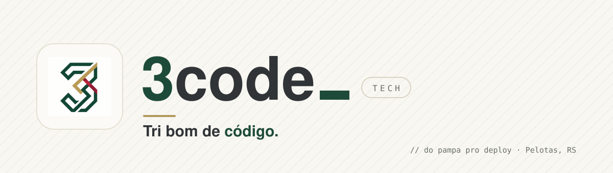

  <a href="https://tricode.tech">
    <picture>
      <source media="(prefers-color-scheme: dark)" srcset="assets/banner-noite.svg" />
      <source media="(prefers-color-scheme: light)" srcset="assets/banner-dia.svg" />
      
    </picture>
  </a>

  
  
  
  

## Três amigos, uma empresa

O **3** se lê *three*, e soa como **"tri"**, o jeito gaúcho de dizer que algo é excelente. A 3Code vive nesse cruzamento: **raiz do Rio Grande do Sul, precisão de engenharia de software.**

Somos uma casa de engenharia formada por três sócios que colocam a mão no código todos os dias. Quem te atende é quem escreve o código: ninguém repassa seu projeto pra um estagiário nem some atrás de uma central de atendimento.

## O que a gente faz

| | Serviço | Na prática |
|---|---|---|
| 🧩 | **Sistemas sob medida** | ERPs internos, portais, painéis de gestão e automações que tiram a planilha das costas da equipe |
| 📱 | **Aplicativos móveis** | Apps iOS e Android com a mesma base de código, publicação nas lojas e atualizações sem dor de cabeça |
| 🛒 | **Sites e e-commerce** | Presença digital rápida, encontrável no Google e pronta pra vender |
| 🔗 | **Integrações e APIs** | Seus sistemas conversando entre si: ERP, meios de pagamento, marketplaces, WhatsApp, nota fiscal |
| ☁️ | **Cloud e DevOps** | Infraestrutura enxuta, deploy automatizado e monitoramento |
| 🛠️ | **Sustentação e evolução** | Já tem sistema rodando? A gente assume, organiza a casa e paga a dívida técnica |

## Cinco passos, zero surpresa

O mesmo caminho em todo projeto, do primeiro café até o sistema no ar.

| | Etapa | O que acontece |
|:---:|---|---|
| `01` | **Entender o problema** | Uma conversa de verdade, sem apresentação decorada. A gente escuta a operação e pergunta o que ninguém perguntou. |
| `02` | **Escopo e preço** | Documento claro do que entra, do que fica de fora, de prazo e de valor. Sem letra miúda. |
| `03` | **Protótipo antes do código** | Telas navegáveis pra você aprovar. Mudar um botão no desenho custa minutos; no código, dias. |
| `04` | **Entregas a cada 2 semanas** | Você acompanha versões funcionando desde o começo. Nada de sumir três meses e reaparecer com surpresa. |
| `05` | **No ar e acompanhado** | Subimos, treinamos seu time e ficamos de olho. Depois, evolução contínua se você quiser. |

## Por que a 3Code

- **Três revisões, um código.** Nada sobe sem passar pelo olho dos outros dois sócios.
- **Prazo é compromisso.** Se um risco aparece, você fica sabendo na hora, com o plano junto.
- **Português, não jargão.** "O servidor caiu" em vez de "instabilidade na infraestrutura". Você decide melhor quando entende.
- **Sem refém de fornecedor.** Repositório, servidores e senhas ficam no nome da sua empresa.

## Ferramenta boa é a que resolve

Tecnologia madura, com comunidade grande e gente disponível no mercado, pra você nunca ficar preso a uma escolha nossa.

  
  
  
  
  
  
  
  

## Três cabeças, um código

<table>
  <tr>
    <td align="center" width="33%">
       
      <strong>Enzo Giacomini</strong> 
      O que planeja 
      Arquitetura e escopo
    </td>
    <td align="center" width="33%">
       
      <strong>Pedro Bortoli</strong> 
      O que constrói 
      Produto e interface
    </td>
    <td align="center" width="33%">
       
      <strong>Bryan Selayaran</strong> 
      O que sustenta 
      Infra e dados
    </td>
  </tr>
</table>

O nosso símbolo conta a mesma história: um **3** feito de três fitas entrelaçadas, uma por fundador, nas cores da bandeira gaúcha. Nenhuma se sustenta sem as outras duas.

## Bora tomar um café? O chimarrão a gente leva.

Conta o que você precisa resolver, mesmo que ainda esteja meio solto na cabeça. A gente responde em até 1 dia útil.

**[tricode.tech](https://tricode.tech)** · **[contato@tricode.tech](mailto:contato@tricode.tech)** · **[WhatsApp](https://wa.me/5554992446581)**

 

<code>// feito a seis mãos, com chimarrão do lado</code>

